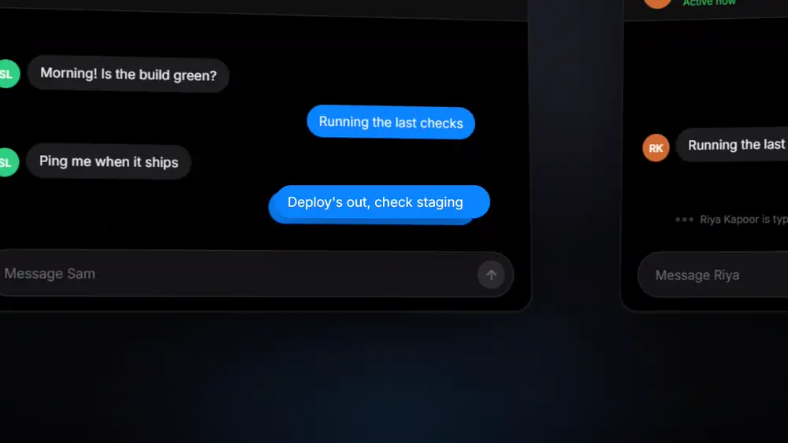
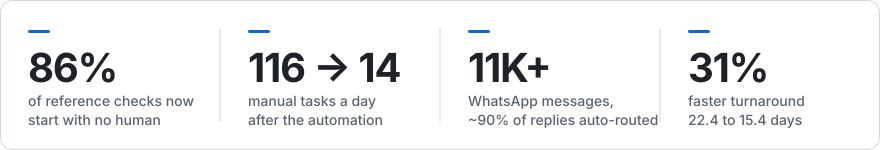
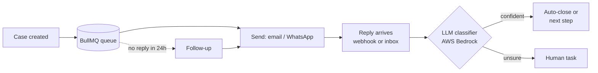

# Pradumya Gaurav

**Backend engineer. I turn manual ops work into automated pipelines: Node.js, queues, LLMs.**

SDE-1 at SpringWorks (background verification) · Bengaluru, IST (UTC+5:30) · open to remote roles and freelance work

[**Email me**](mailto:pradumya.official@gmail.com) · [LinkedIn](https://www.linkedin.com/in/pradumya2004/) · [Portfolio](https://pradumya-gaurav-portfolio.vercel.app/)

## Results in production

<picture>
  <source media="(prefers-color-scheme: dark)" srcset="assets/impact-dark.svg">
  
</picture>

**Reference-check automation.** Checks start themselves, follow up every 24 hours, and an LLM on AWS Bedrock reads each reply and decides the next step. 
**WhatsApp on Meta Cloud API.** I proposed and built it: send pipeline, webhooks, BullMQ queues, template sync, an agent inbox and a reply classifier, rolled out behind flags from 1% to 100%. 
**AI in the pipeline.** A YOLO + OpenCV document auto-crop service (2.25x recall on 411 production images), and LLM triage that hands anything unsure to a human.

<b>How one of these pipelines works</b>

Every step is a queued job with retries, rate limits and a feature flag per rollout stage. The model never closes a case it is unsure about.

Work code is private. Numbers come from production data.

## Selected work

<table>
<tr>
<td width="50%" valign="top">

<h3>BuzzBell</h3>
Realtime chat with no app server. Postgres Row Level Security is the whole authorization layer, and 34 SQL checks try to break it.

<a href="https://buzz-bell-ycsb.vercel.app">Live</a> · <a href="https://github.com/pradumya004/BuzzBell">Code</a> · <a href="https://github.com/pradumya004/BuzzBell/blob/main/docs/launch.mp4">Film</a>
</td>
<td width="50%" valign="top">

<h3>Pawse</h3>
Watch a movie together from two cities. Clock sync and drift correction keep players 6 ms apart (350 ms before); the file goes peer to peer.

<a href="https://pawsetv.vercel.app">Live</a> · <a href="https://github.com/pradumya004/pawse">Code</a> · <a href="https://github.com/pradumya004/pawse/blob/master/docs/launch.mp4">Film</a>
</td>
</tr>
<tr>
<td width="50%" valign="top">

<h3>Bowl n Sticks</h3>
QR menu and admin panel for a cafe in Karwar, built for a freelance client. The owners run the menu themselves; RLS decides who can write. 83 tests.

<a href="https://bowl-n-sticks.vercel.app">Live</a> · <a href="https://github.com/pradumya004/bowl-n-sticks">Code</a> · <a href="https://github.com/pradumya004/bowl-n-sticks/blob/main/docs/launch.mp4">Film</a>
</td>
<td width="50%" valign="top">

<h3>Swastik Platinum</h3>
A real-estate site study, first built for an assessment, then rebuilt. The page climbs the tower floor by floor and reads units off the plans.

<a href="https://swastik-platinum.vercel.app">Live</a> · <a href="https://github.com/pradumya004/Swastik-Platinum">Code</a> · <a href="https://github.com/pradumya004/Swastik-Platinum/blob/main/docs/launch.mp4">Film</a>
</td>
</tr>
</table>

## What I can build for you

| | |
|---|---|
| **Automate a manual workflow** | The repetitive steps your team does by hand: queued jobs, follow-ups, webhooks, and LLM triage with a human fallback. |
| **Messaging and integrations** | WhatsApp Cloud API, email (SES), third-party APIs and webhooks, with retries and delivery tracking. |
| **Postgres and realtime backends** | Supabase or plain Postgres: schema, Row Level Security, realtime, and tests that try to break it. |
| **Product frontends** | React and Next.js apps that ship with the backend, not after it. |

## Stack

<table>
<tr><td><b>Backend</b></td><td></td></tr>
<tr><td><b>Data</b></td><td></td></tr>
<tr><td><b>Cloud and AI</b></td><td></td></tr>
<tr><td><b>Frontend</b></td><td></td></tr>
</table>

## Experience

| | | |
|---|---|---|
| **SpringWorks** | SDE-1 · 2026 to now | Backend automation, queues, LLM routing, WhatsApp Cloud API. 148 merged PRs. |
| **GetMax Solutions** | Software Engineer Intern · 2025 | Built [getmaxhealthcare.com](https://www.getmaxhealthcare.com) end to end and internal tools for US healthcare ops. |
| **IIIT Vadodara** | B.Tech CSE · 2026 | Teaching assistant for Design and Analysis of Algorithms (200+ students). |

<picture>
  <source media="(prefers-color-scheme: dark)" srcset="https://raw.githubusercontent.com/pradumya004/pradumya004/output/activity-dark.svg">
  
</picture>

**Have a process that eats hours every week?** [Email me](mailto:pradumya.official@gmail.com) with what it is, and I'll tell you how I'd automate it.
