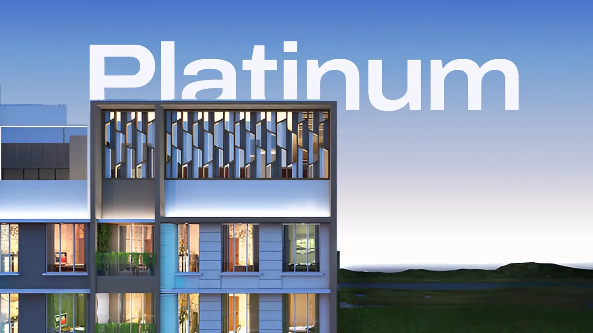

# Pradumya Gaurav

**Backend engineer. I turn manual ops work into automated pipelines: Node.js, queues, LLMs.**

SDE-1 at SpringWorks, a background-verification platform, in Bengaluru. Open to remote.

## What I build at work

**Reference-check automation.** Checks start themselves, follow up every 24 hours, and an LLM on AWS Bedrock reads the manager's reply. 86% of checks now start without a human, manual tasks fell from 116 to 14 a day, and turnaround dropped 31%.

**WhatsApp on Meta Cloud API.** I proposed it and built it: send pipeline, webhooks, BullMQ queues, template sync, an agent inbox and a reply classifier, rolled out behind flags from 1% to 100%. 11K+ messages in 10 weeks, about 90% of replies routed with no agent.

**AI in the verification pipeline.** A YOLO + OpenCV document auto-crop service (2.25x recall on 411 production images), and LLM classification of free text that falls back to a human when unsure.

Work code is private. Numbers come from production data.

## Selected work

### BuzzBell

Realtime chat with no app server. The browser talks straight to Postgres, Row Level Security is the whole authorization layer, and 34 SQL checks try to break it.

React · TypeScript · Supabase Realtime · Postgres RLS · Vitest 
[Live](https://buzz-bell-ycsb.vercel.app) · [Code](https://github.com/pradumya004/BuzzBell) · [Film](https://github.com/pradumya004/BuzzBell/blob/main/docs/launch.mp4)

### Pawse

Watch a movie together from two places. Clock sync and drift correction keep the players 6 ms apart (350 ms before) under 150 ms of simulated delay. The file goes peer to peer over WebRTC.

React · Node.js WebSocket relay · WebRTC DataChannel · Chrome extension 
[Live](https://pawsetv.vercel.app) · [Code](https://github.com/pradumya004/pawse) · [Film](https://github.com/pradumya004/pawse/blob/master/docs/launch.mp4)

### Bowl n Sticks

QR menu and admin panel for a cafe in Karwar, built for a freelance client. One permanent QR per table, the owner edits dishes and photos, and Postgres RLS decides who can write. 83 tests.

Next.js · Supabase · Postgres RLS · dnd-kit 
[Live](https://bowl-n-sticks.vercel.app) · [Code](https://github.com/pradumya004/bowl-n-sticks) · [Film](https://github.com/pradumya004/bowl-n-sticks/blob/main/docs/launch.mp4)

### Swastik Platinum

A site study I first built for a frontend assessment, then rebuilt. The page climbs the tower floor by floor, and the floor picker reads units off the developer's plans. Unofficial.

React · Tailwind CSS · scroll-driven layers · Playwright 
[Live](https://swastik-platinum.vercel.app) · [Code](https://github.com/pradumya004/Swastik-Platinum) · [Film](https://github.com/pradumya004/Swastik-Platinum/blob/main/docs/launch.mp4)

## Experience

**SpringWorks** · SDE-1 · 2026 
Backend automation, queues, LLM routing, WhatsApp Cloud API. 148 merged PRs.

**GetMax Solutions** · Software Engineer Intern · 2025 
Built [getmaxhealthcare.com](https://www.getmaxhealthcare.com) end to end, plus internal tools for US healthcare ops.

**IIIT Vadodara** · B.Tech CSE, 2026 
Teaching assistant for Design and Analysis of Algorithms.

## Stack

| | |
|---|---|
| Backend | Node.js, TypeScript, Express, BullMQ, Redis, REST, webhooks |
| Data | MySQL, PostgreSQL, Supabase |
| AI and cloud | AWS Bedrock, SES, S3, LLM classification, YOLO, OpenCV |
| Frontend | React, Next.js, Tailwind CSS |
| Realtime | WebSockets, WebRTC, Supabase Realtime |

<picture>
  <source media="(prefers-color-scheme: dark)" srcset="https://raw.githubusercontent.com/pradumya004/pradumya004/output/activity-dark.svg">
  
</picture>

[pradumya.official@gmail.com](mailto:pradumya.official@gmail.com) · [LinkedIn](https://www.linkedin.com/in/pradumya2004/) · [Portfolio](https://pradumya-gaurav-portfolio.vercel.app/)
