<picture>
  <source media="(prefers-color-scheme: dark)" srcset="./header-dark.svg">
  
</picture>

SDE-1 at **SpringWorks**, building automation for a background-verification platform. Before that I built [getmaxhealthcare.com](https://www.getmaxhealthcare.com) and internal tools at GetMax Solutions, a US healthcare RCM company. Bengaluru, open to remote.

### Production work

- **Reference-check automation.** Auto-initiation, a 24h follow-up cadence, an in-product verifier form, and LLM classification of manager email replies on AWS Bedrock. 86% of checks now start without a human, manual tasks fell from 116 to 14 a day, turnaround dropped 31%.
- **WhatsApp on Meta Cloud API.** Proposed and built it: send pipeline, webhooks, BullMQ queues, template sync, an agent inbox and an AI reply classifier. 11K+ messages in the first 10 weeks, 80-91% delivered, about 90% of replies routed with no agent.
- **AI in the verification pipeline.** A YOLO + OpenCV document auto-crop service (2.25x recall on a 411-image production set) and LLM classification of free-text input that fails closed to a human.

Work code is private. Numbers come from production data.

### Projects

| | |
|---|---|
| **[Pawse](https://github.com/pradumya004/pawse)** · [live](https://pawsetv.vercel.app) | Watch-together for long-distance couples. Play, pause and seek synced over a WebSocket relay; your own movie file sent peer to peer over WebRTC, original bytes. |
| **[Bowl n Sticks](https://github.com/pradumya004/bowl-n-sticks)** · [live](https://bowl-n-sticks.vercel.app) | QR menu and admin panel for a cafe (freelance client). Next.js, Supabase Auth + Row Level Security, drag-and-drop menu editor. |

### Stack

Node.js · TypeScript · Express · BullMQ · Redis · MySQL · PostgreSQL · MongoDB · AWS (SES, Bedrock, S3) · React · Next.js · Supabase · WebSockets · WebRTC

### Contact

[pradumya.official@gmail.com](mailto:pradumya.official@gmail.com) · [LinkedIn](https://www.linkedin.com/in/pradumya2004/) · [Portfolio](https://pradumya-gaurav-portfolio.vercel.app/)
