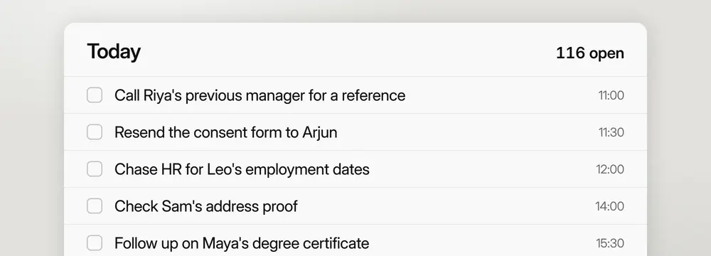
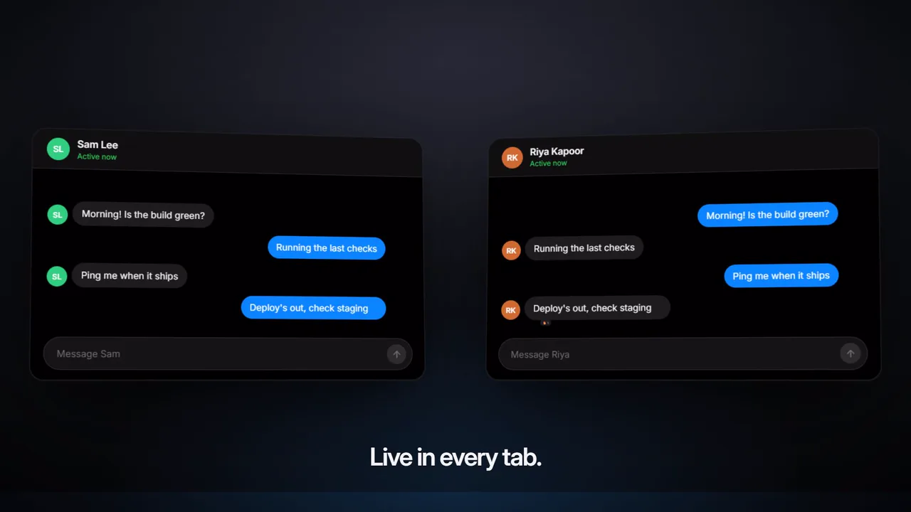
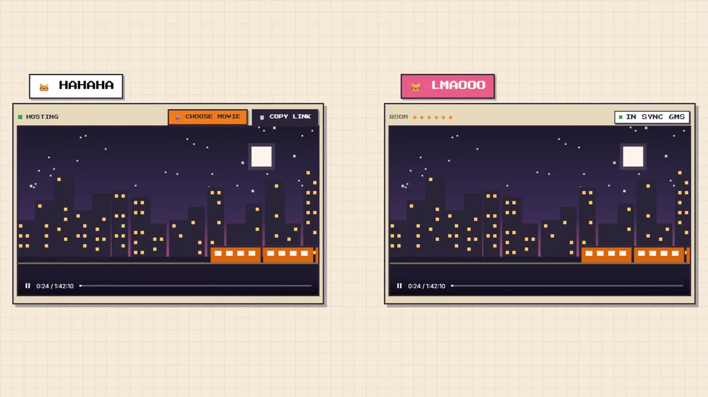
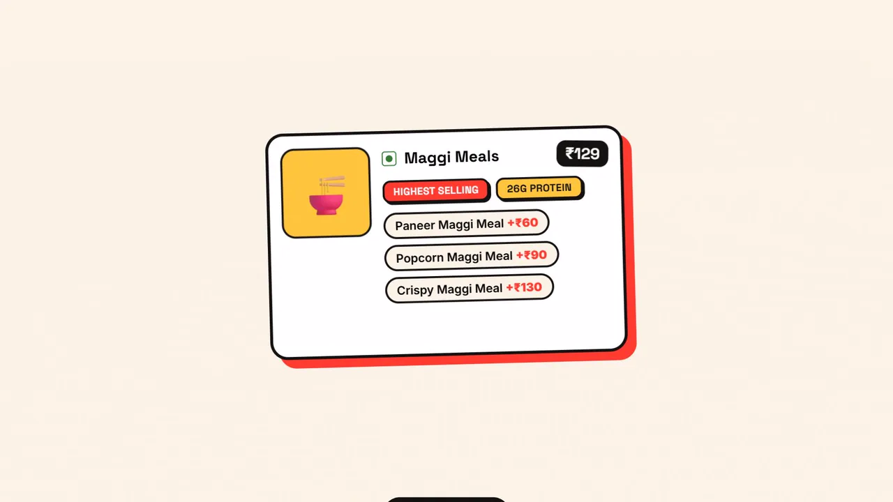

## Pradumya Gaurav

Backend engineer in Bengaluru. I turn manual ops work into automated pipelines with Node.js, queues and LLMs. SDE-1 at SpringWorks, a background-verification platform. Before that I built [getmaxhealthcare.com](https://www.getmaxhealthcare.com) and internal tools at GetMax Solutions. Open to remote.

### Production work

- **Reference-check automation.** Auto-initiation, a 24h follow-up cadence, an in-product verifier form, and LLM classification of manager replies on AWS Bedrock. 86% of checks now start without a human, manual tasks fell from 116 to 14 a day, turnaround dropped 31%.
- **WhatsApp on Meta Cloud API.** Proposed and built it: send pipeline, webhooks, BullMQ queues, template sync, an agent inbox and a reply classifier, rolled out behind flags from 1% to 100%. 11K+ messages in 10 weeks, about 90% of replies routed with no agent.
- **AI in the verification pipeline.** A YOLO + OpenCV document auto-crop service (2.25x recall on a 411-image production set) and LLM classification of free text that fails closed to a human.

Work code is private. Numbers come from production data.

### Projects

**[BuzzBell](https://github.com/pradumya004/BuzzBell)**: realtime chat on Postgres. Two guests in a DM: typing, delivery and reactions arrive live, and Row Level Security decides who reads what. 34 SQL checks try to break it.
 React · TypeScript · Supabase Realtime · Postgres RLS · Vitest

**[Pawse](https://github.com/pradumya004/pawse)** · [live](https://pawsetv.vercel.app): watch movies together from two places. Play, pause and seek sync over a WebSocket relay; the movie file goes peer to peer over WebRTC. The two players stayed about 0.1 s apart in a recorded test.
 React · Node.js ws relay · WebRTC DataChannel · Chrome MV3

**[Bowl n Sticks](https://github.com/pradumya004/bowl-n-sticks)** · [live](https://bowl-n-sticks.vercel.app): QR menu and admin panel for a cafe in Karwar (freelance client). One permanent QR per table; owners edit dishes, photos and order themselves, and Postgres Row Level Security decides who can write. 83 tests on the server actions.
 Next.js 16 · Supabase · Postgres RLS · dnd-kit

 

### Experience

- **SpringWorks** · SDE-1 · backend automation, queues, LLM routing, WhatsApp Cloud API. 148 merged PRs.
- **GetMax Solutions** · built getmaxhealthcare.com end to end and internal tools for US healthcare ops.
- **IIIT Vadodara** · B.Tech CSE (2026); teaching assistant for Design and Analysis of Algorithms.

### Stack

Node.js · TypeScript · Express · BullMQ · Redis · MySQL · PostgreSQL · AWS (SES, Bedrock, S3) · React · Next.js · Supabase · WebSockets · WebRTC

<picture>
  <source media="(prefers-color-scheme: dark)" srcset="https://raw.githubusercontent.com/pradumya004/pradumya004/output/activity-dark.svg">
  
</picture>

[pradumya.official@gmail.com](mailto:pradumya.official@gmail.com) · [LinkedIn](https://www.linkedin.com/in/pradumya2004/) · [Portfolio](https://pradumya-gaurav-portfolio.vercel.app/)
