<picture>
  <source media="(prefers-color-scheme: dark)" srcset="assets/hero-dark.svg">
  
</picture>

 

SDE-1 at **SpringWorks**, building automation for a background-verification platform. Before that I built [getmaxhealthcare.com](https://www.getmaxhealthcare.com) and internal tools at GetMax Solutions, a US healthcare RCM company. Open to remote.

### In production

<picture>
  <source media="(prefers-color-scheme: dark)" srcset="assets/stats-dark.svg">
  
</picture>

- **Reference-check automation.** Auto-initiation, a 24h follow-up cadence, an in-product verifier form, and LLM classification of manager email replies on AWS Bedrock that routes each one to grading, clearance or follow-up.
- **WhatsApp on Meta Cloud API.** Proposed and built it: send pipeline, webhooks, BullMQ queues, template sync, an agent inbox and an AI reply classifier, rolled out behind flags from 1% to 100%.
- **AI in the verification pipeline.** A YOLO + OpenCV document auto-crop service (2.25x recall on a 411-image production set) and LLM classification of free text that fails closed to a human.

Work code is private. Numbers come from production data.

### Selected work

<a href="https://github.com/pradumya004/pawse">
  <picture>
    <source media="(prefers-color-scheme: dark)" srcset="assets/pawse-dark.svg">
    
  </picture>
</a>

[Code](https://github.com/pradumya004/pawse) · [Live](https://pawsetv.vercel.app)

<a href="https://github.com/pradumya004/bowl-n-sticks">
  <picture>
    <source media="(prefers-color-scheme: dark)" srcset="assets/bowl-dark.svg">
    
  </picture>
</a>

[Code](https://github.com/pradumya004/bowl-n-sticks) · [Live](https://bowl-n-sticks.vercel.app)

### Experience

<picture>
  <source media="(prefers-color-scheme: dark)" srcset="assets/timeline-dark.svg">
  
</picture>

### Stack

<picture>
  <source media="(prefers-color-scheme: dark)" srcset="assets/stack-dark.svg">
  
</picture>

### Activity

<picture>
  <source media="(prefers-color-scheme: dark)" srcset="https://raw.githubusercontent.com/pradumya004/pradumya004/output/activity-dark.svg">
  
</picture>

  <a href="mailto:pradumya.official@gmail.com">pradumya.official@gmail.com</a> &nbsp;·&nbsp;
  <a href="https://www.linkedin.com/in/pradumya2004/">LinkedIn</a> &nbsp;·&nbsp;
  <a href="https://pradumya-gaurav-portfolio.vercel.app/">Portfolio</a>

<!-- Tiles are generated: python scripts/build.py -->
